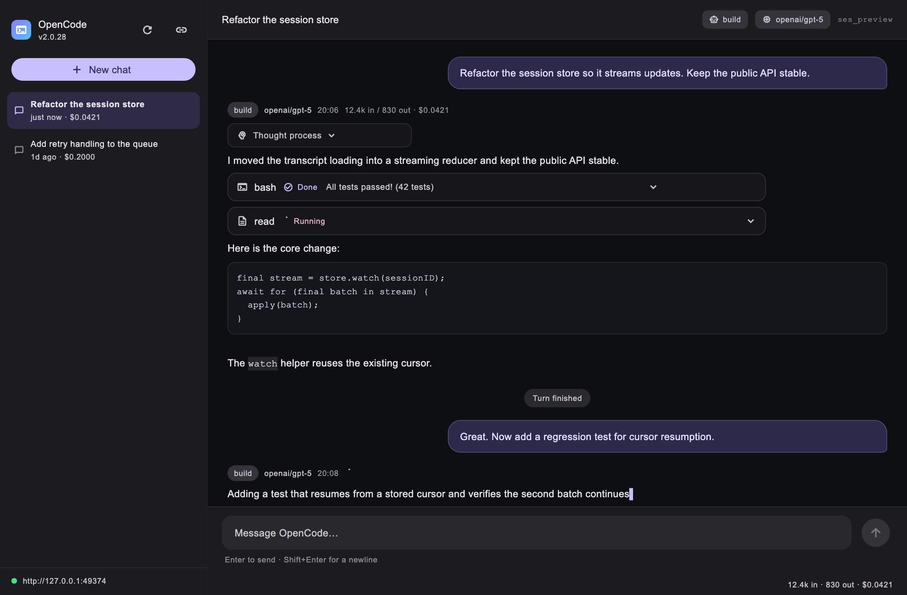

# OpenCode Chat (macOS)

A native macOS chat client for your local OpenCode server, built with Flutter
and [`opencode_sdk_dart`](../README.md).



## Features

- **Zero-config startup**: discovers the local OpenCode background service
  (`~/.local/state/opencode/service.json`) and starts it when needed, or
  connects to any `http(s)://` server manually.
- **Streaming transcripts**: assistant text, reasoning, tool calls, and
  turn status stream live from the server's event connection — no polling.
- **Tool cards**: each tool call renders with its live status
  (Preparing / Running / Done / Failed), streamed input, and result preview.
- **Session sidebar**: newest-first session list with per-session cost,
  busy spinners, rename/delete, and one-click new chat.
- **Agent & model switching**: pick the agent and model for a session from
  the header.
- **Permission prompts**: `permission.asked` events surface an inline banner
  with Reject / Allow once / Always allow, wired to `permission.reply`.
- **Interrupt & queue**: stop a running turn, or send another message while
  the agent is working (the server steers/queues it).
- **Desktop ergonomics**: Enter to send, Shift+Enter for newlines, ⌘N for a
  new chat, selectable text, auto-scroll that yields when you scroll up.

## Run it

```sh
cd chat_app
flutter pub get
flutter run -d macos
```

Or build a bundle and launch it:

```sh
flutter build macos --release
open build/macos/Build/Products/Release/opencode_chat.app
```

## Tests

```sh
flutter test                          # unit + UI preview tests
flutter test tool/live_chat_check.dart  # live end-to-end against a running server
```

- `test/event_reducer_test.dart` — the event → transcript reducer, driven by
  recorded server event payloads.
- `test/ui_preview_test.dart` — renders the app with real macOS fonts and
  writes screenshots to `test/previews/`; also covers Enter/Shift+Enter
  composer behavior.
- `tool/live_chat_check.dart` — creates a session, prompts it, verifies the
  streamed answer lands in the transcript, then deletes the session.

## Architecture

```text
lib/
  main.dart                     app entry; owns the controller lifecycle
  src/
    app.dart                    Material theme and shell
    chat_controller.dart        connection, sessions, prompts, event reducer
    chat_models.dart            transcript view models + API decoding
    home_screen.dart            sidebar + transcript layout, header, status bar
    session_sidebar.dart        session list, rename/delete, connection state
    chat_transcript.dart        message bubbles, reasoning blocks, tool cards
    composer.dart               input box with Enter-to-send handling
    permission_banner.dart      permission request replies
    connect_screen.dart         discovery / manual connection flow
    markdown_lite.dart          code-block and inline-code aware renderer
```

The controller owns a single `OpenCodeClient`:

1. `connect` discovers the service (or takes a URL), reads `server.info`,
   loads sessions/agents/models, and subscribes to `client.event.subscribe()`.
2. Every event is reduced into transcript state: `session.step.started`
   creates the assistant message, `session.text.delta` appends streamed text,
   `session.tool.*` drives tool cards, `session.execution.*` toggles the busy
   indicator and settles the transcript from the API.
3. Sending a prompt echoes the user message immediately, then refreshes from
   the API once the server admits it.

## macOS notes

- The App Sandbox is **disabled** (`macos/Runner/*.entitlements`). A sandboxed
  app cannot read the service registration file or spawn `opencode serve`,
  which the auto-discovery flow needs. If you only ever connect to remote
  servers, you can re-enable the sandbox and add
  `com.apple.security.network.client`.
- The window defaults to 1180×780 (min 900×600) and is titled "OpenCode Chat".
