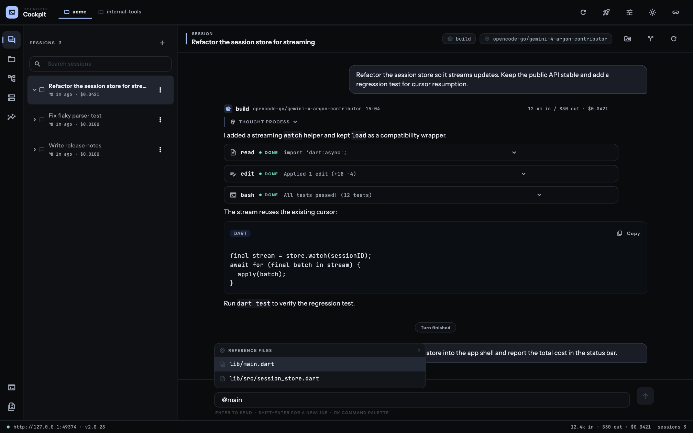
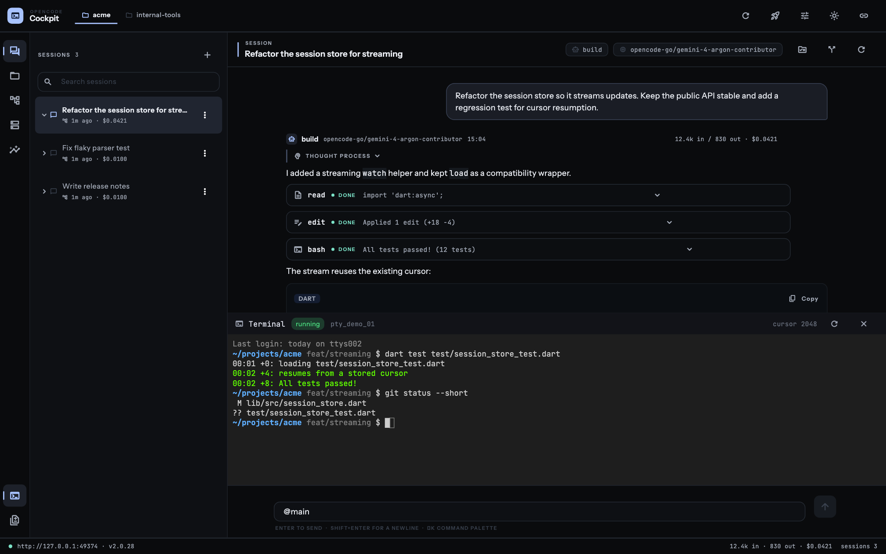
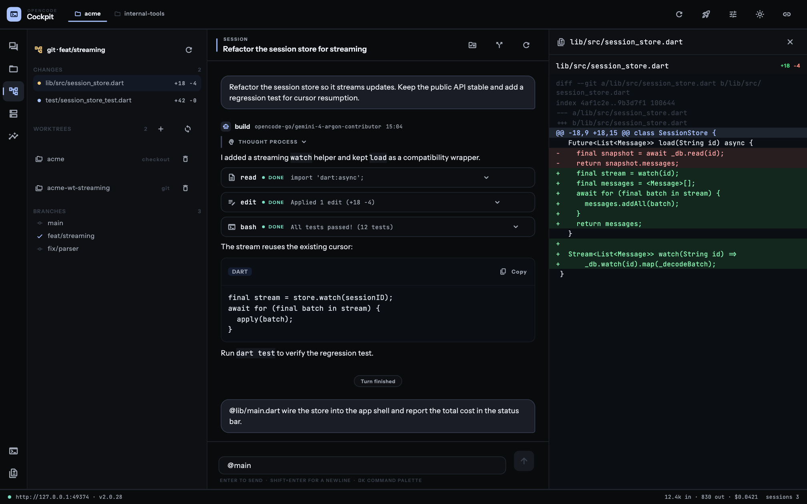
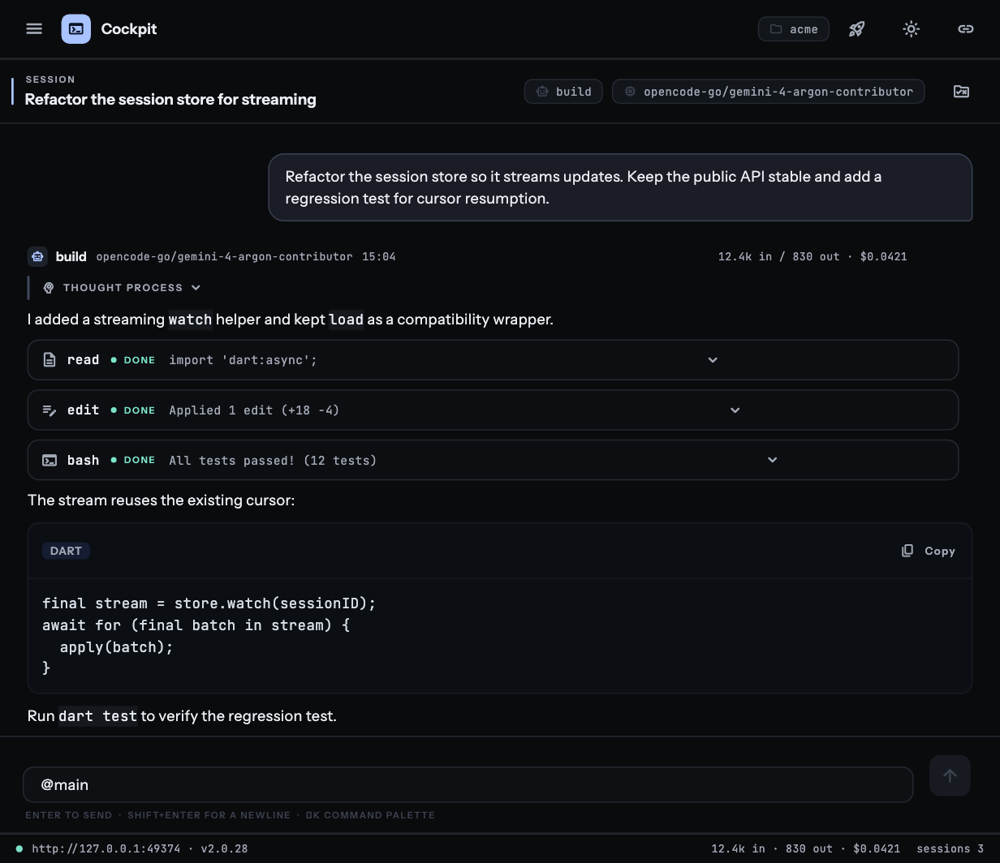

# OpenCode Cockpit (macOS + Web)

A Flutter desktop **workbench for OpenCode V2** — the CodeNomad-style cockpit,
built entirely on [`opencode_sdk_dart`](../README.md). It exercises the SDK's
deeper capabilities: session trees, worktrees, session diffs, the filesystem
API, VCS endpoints, git worktrees, plugin-event streaming, and **real PTY
terminals over the SDK's WebSocket helpers**.

It also builds for the **web** (a LAN host serves the app and proxies the API
and WebSockets same-origin) and adapts to narrow screens with drawers.






## Features

**Workspace**

- **Project tabs** from `project.list()` — every project is a tab; sessions,
  files, git, and new sessions are scoped to the active project's location.
- **Session tree** — roots via `parentID: null`, lazily expanded sub-sessions,
  search by title/id, rename, fork (`session.fork`), delete, and per-session
  cost.
- **Activity rail** — Sessions / Files / Git / Statistics, plus toggles for the
  terminal and the changes inspector.
- **Command palette** (⌘K), light/dark themes (⌘⇧I), connection status bar.
- **Responsive layout** — below ~1024 px the rail + explorer collapse into a
  drawer opened from the top bar, the inspector becomes an end drawer, the
  terminal stays a bottom panel, and the top bar condenses (menu, title,
  project picker, key actions).

**Conversation**

- Streaming transcript from the live event stream: text, reasoning, tool cards
  (status, streamed input, result preview), notices, errors, per-turn tokens
  and cost.
- **Large transcripts**: the server cursor paginates history with a
  "Load earlier messages" affordance; messages dedupe on append.
- **Inbox strip**: queued and steering prompts are visible while a turn runs,
  with cancel and steer/queue delivery switching (`session.inbox.*`).
- **Agent forms**: when the agent asks a structured question
  (`form.created`), a badge opens a rendered form — dropdowns, numbers,
  toggles, multiselect chips, conditional fields, and external approval
  links — submitted via `session.form.reply`.
- **Export / import**: write a session transcript as pretty JSON
  (`session.exportSession`) or import one from disk (`session.importSession`).
  Desktop uses path dialogs (`~/Downloads` suggestion); the web build
  downloads a Blob and imports through the browser's file picker.
- Agent and model switching from the header (`session.switchAgent` /
  `switchModel`). The model picker is a **searchable dialog** over every
  `providerID/modelID` with a checkmark on the current model.
- Composer with Enter-to-send, Shift+Enter newline, interrupt, queue-while-busy,
  and **`@` file references** backed by `filesystem.find`; candidates render in
  a floating card above the input.
- Permission prompts inline (`permission.asked` → Reject / Allow once /
  Always allow via `permission.reply`).

**Files**

- Directory browser via `filesystem.list` with breadcrumbs.
- Inspector with a line-numbered text viewer, image preview, binary detection,
  and "insert `@reference`" into the prompt.

**Git**

- Branch header (`vcs.get`), uncommitted changes (`vcs.status`) with +/-
  counts, branch list (`vcs.branchList`), and **worktree management**
  (`worktree.list/create/remove`).
- Unified **diff viewer** with colored hunks for working-copy diffs
  (`vcs.diff`) and for the session's own changes (`session.diff`).

**Terminal**

- Real PTY sessions: `pty.create` → ticket handshake →
  `PtySocket.frames` stream (`PtyOutput` / `PtyCursor`) → xterm emulation.
- ANSI colors, interactive input, debounced resize through `pty.update`,
  resume cursors, restart/start-fresh controls, and clean shutdown on exit.
- **Persistent terminals** (`persistentPty.*`): session-scoped shells that
  survive app restarts. The cockpit lists, creates, attaches, snapshots, and
  kills them, and speaks the server's `input_protocol=1` framing
  (`PtyInputFrames`: 5-byte header with type + cols/rows per frame) so
  keystrokes and resizes travel together.

**Connections and settings**

- MCP tab: list servers with status chips, connect/disconnect/remove, and add
  local or remote servers (`mcp.*`).
- Plugins tab: inventory with update checks and bulk updates (`plugin.*`).
- Config tab: effective configuration entries, shell selection
  (`config.update`), and configuration reload (`location.reload`).

**Statistics**

- `session.stats` dashboard: sessions, prompts, steps, tokens, cost, streak,
  tool reliability bars, and a 21-day activity chart.

## Run it

Desktop:

```sh
cd opencode_cockpit
flutter pub get
flutter run -d macos
```

Or build and open the bundle:

```sh
flutter build macos --release
open build/macos/Build/Products/Release/opencode_cockpit.app
```

Web (also used for LAN/mobile access):

```sh
flutter run -d chrome                     # local development
flutter build web --release --base-href /cockpit/
```

Serve `build/web` from any host that proxies `/api/*` and the event/PTY
WebSockets to the OpenCode server. On the web the cockpit connects to
`Uri.base.origin` (same-origin LAN host). To point any platform at an explicit
server instead, pass a dart-define:

```sh
flutter run -d chrome --dart-define=OPENCODE_BASE_URL=http://192.168.1.20:4096
```

## Tests

```sh
flutter test                            # controller, widgets, previews
flutter test tool/live_cockpit_check.dart  # live end-to-end (needs a server)
```

- `test/cockpit_controller_test.dart` — event reducer, session tree filtering,
  permissions, busy tracking, `@` reference insertion, theme toggle, and
  notification coalescing.
- `test/cockpit_effect_test.dart` — the effect-bridge contracts: reads retry
  transient failures (three attempts), writes are never retried, typed
  `OpenCodeError` surfacing, event-stream ordering through `toNative`, and
  fiber cancellation on dispose.
- `test/effect_socket_test.dart` — PTY and event lifecycles against a real
  loopback server: `ptyConnect`/`ptyText`/`ptyClose` through
  `acquireUseRelease`, resume cursors, framed persistent input, detach without
  killing the server-side terminal, and SSE teardown on dispose.
- `test/ui_preview_test.dart` — renders the screens with the bundled UI/mono
  faces and writes them to `test/previews/` (including the narrow layout).
- `test/model_picker_test.dart` — searchable model dialog: full catalog,
  filtering, current-model checkmark, selection.
- `test/markdown_lite_test.dart` — headings, lists, quotes, rules, and the
  copy button of fenced code blocks.
- `test/cockpit_integration_test.dart` — drives the controller against a
  mocked server: connect, inbox cancel/delivery, form reply payloads, older
  message pagination with dedupe, and export/import round trips.
- `tool/live_cockpit_check.dart` — connects to the real service and verifies
  projects, session tree, file listing/reading, file search, git state,
  session diff/inbox/forms, statistics, a live terminal echo
  (`COCKPIT_PTY_OK`), transcript export, and a full persistent-terminal
  lifecycle including framed input and cleanup.

## Keyboard shortcuts

| Shortcut | Action |
| --- | --- |
| ⌘K | Command palette |
| ⌘N | New session |
| ⌘J | Toggle terminal |
| ⌘⇧I | Toggle light/dark theme |
| Enter | Send |
| Shift+Enter | Newline |
| Esc | Close the mention popup / palette |

The palette also reaches Persistent terminals, Connections and settings,
Load older messages, Export/Import session, and Pending forms.

## Architecture

```text
lib/
  main.dart                       app entry, controller lifecycle
  src/
    app.dart                      MaterialApp + themes
    shell.dart                    top bar, activity rail, responsive layout,
                                  status bar
    cockpit_controller.dart       connection, projects, sessions, panels,
                                  live event reducer, palette commands
    models.dart                   transcript view models + API decoding
    session_transfer.dart         conditional export of the platform
                                  export/import helper (io vs web)
    terminal_session.dart         PTY lifecycle + xterm binding
    services/persistent_terminal.dart
                                  persistent PTY lifecycle + framed input
    markdown_lite.dart            code-aware markdown renderer
    theme.dart                    dark/light palettes + mono font stack
    widgets/                      transcript, composer, explorers, panels,
                                  diff view, terminal, palette, inspector,
                                  model picker
```

The controller mirrors the reference client's event semantics (the same
reducer as `chat_app`, extended with project/session-tree/panel state).

All server work runs through the effect bridge (`opencode_effect` over
`effect_core`): one `Runtime` and one `EffectOpenCodeClient` per controller
lifetime, `client.call(...)` for every resource method, `withReadRetry()` on
reads only (three attempts, transient statuses — the old transport
`RetryPolicy` defaults), `OpenCodeError` as the typed failure channel, the
shared event stream consumed through `EffectStream.toNative`, and forked
fibers for the PTY sockets (acquired with `Effect.acquireUseRelease`, consumed
through `ptyText`, released with `ptyClose`). `dispose()` interrupts the
fibers, closes the client, and shuts the runtime down.

The Connections dialog is the one widget that still talks to the generated
resources directly, so the controller keeps exposing the raw client
(`controller.client`) for it; everything below the widget layer is
effect-based.

## Notes

- The App Sandbox is disabled (same rationale as `chat_app`): the app reads the
  service registration file and may start `opencode serve`.
- PTY sessions are scoped to a location; the cockpit always passes the active
  project's directory to `pty.create`, `pty.update`, `pty.remove`, and the
  WebSocket handshake, and disposes them on exit.
- `xterm` (MIT) provides the terminal emulation and rendering; it compiles for
  the web build, where the SDK opens the PTY socket through the browser's
  WebSocket API (tickets in the URL, no custom headers).
- Session export/import is platform-aware (`session_transfer_io.dart` /
  `session_transfer_web.dart` behind `session_transfer.dart`): desktop writes
  and reads files, the web downloads a Blob and reads through an
  `<input type="file">` picker. `dart:io` never leaks into the shared widgets.
- The theme uses bundled **Instrument Sans** for UI and **JetBrains Mono** for
  code, paths and terminal chrome (`kMonoTextStyle`), so typography is
  identical on macOS, the web build and the widget-test previews. Both are
  OFL-licensed under `assets/fonts/`.
- The dark and light palettes are semantic tokens in `theme.dart`: a graphite
  chrome, warm paper light mode, one cobalt signal accent, mint for success and
  amber for warnings. Selected rows, active rail items and tool states all
  resolve through those tokens rather than ad-hoc hex values.
- The controller coalesces listener updates to one per ~16 ms frame; streaming
  transcripts scroll with `jumpTo` while the active message streams and with a
  short animation otherwise.
